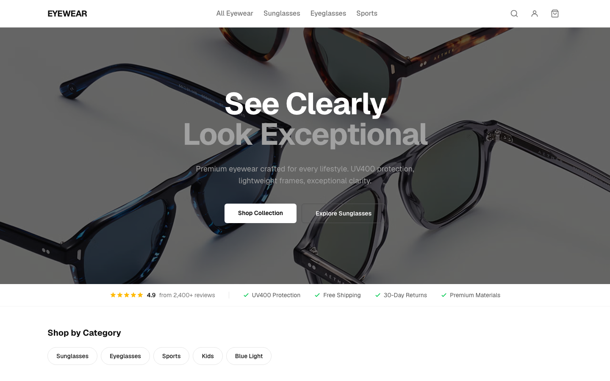
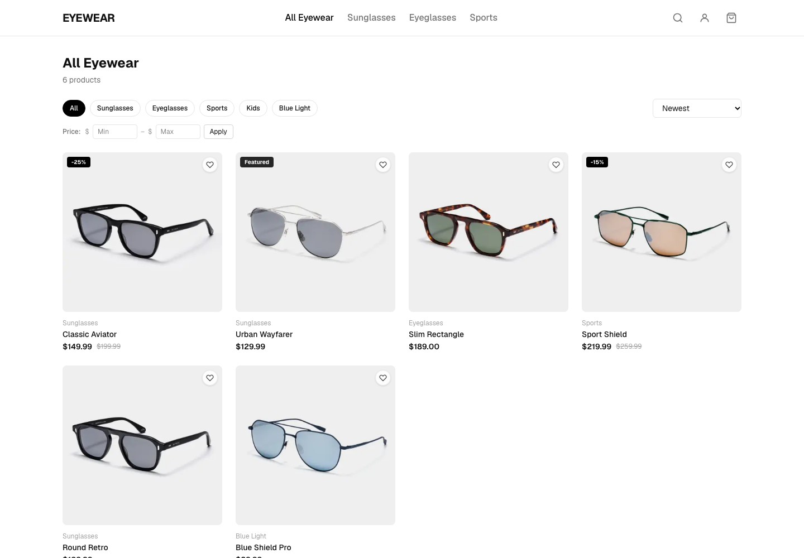

# Eyewear Store

A full-stack e-commerce store for eyewear (glasses and sunglasses). It includes a public storefront, customer accounts, Stripe checkout, and an admin dashboard.

## Live Site

- https://eyewear-store-murex.vercel.app/

## Screenshots

| Home | Products |
| --- | --- |
|  |  |

Mobile view:


## Demo Access

- **Customer:** open the live site, then register a new account at `/register`. Use a test card in checkout, for example `4242 4242 4242 4242` (Stripe test mode, any future date, any CVC).
- **Admin (`/admin`):** there is no public admin account. For security, admin credentials are not published in this repository. To get admin access in your own deployment, follow [Create an admin user](#database-setup-supabase).
- **Reviewers:** to request a demo admin account on the live site, contact the repository owner.

## Table of Contents

- [Screenshots](#screenshots)
- [Demo Access](#demo-access)
- [Features](#features)
- [Tech Stack](#tech-stack)
- [Project Structure](#project-structure)
- [Getting Started](#getting-started)
- [Environment Variables](#environment-variables)
- [Database Setup (Supabase)](#database-setup-supabase)
- [Stripe Setup](#stripe-setup)
- [Scheduled Jobs](#scheduled-jobs)
- [API Routes](#api-routes)
- [Key Conventions](#key-conventions)
- [Scripts](#scripts)
- [Deployment](#deployment)
- [License](#license)

## Features

### Storefront

- Product listing with filters (price, category), sorting, and pagination
- Product detail page with gallery, variant selector (color, size), and stock status
- Collections (category pages)
- Search with instant autocomplete suggestions
- Product bundles and cross-sell
- Recently viewed products
- Customer reviews and ratings (with admin moderation)
- Wishlist
- Back-in-stock waitlist with email notification
- Newsletter subscription
- Static content pages: FAQ, Shipping and Returns, Frame Sizing Guide, Contact, About, Privacy, Terms
- SEO: metadata, `sitemap.xml`, `robots.txt`

### Cart and Checkout

- Client-side cart (Zustand, saved in `localStorage` key `eyewear-cart`)
- Cart drawer
- Guest checkout and signed-in checkout
- Stripe payments, including Apple Pay and Google Pay
- Discount codes (coupons) with server-side validation
- Gift cards: purchase, validate, and redeem
- Free orders (zero total) without payment
- Abandoned cart recovery by email, with a recovery link
- Order confirmation page and order history

### Accounts

- Email and password sign-up and login
- Google OAuth (social login)
- Email confirmation and password reset
- Profile management, order history, and wishlist

### Admin Dashboard (`/admin`, role-gated)

- Analytics: KPIs, revenue chart, order status chart
- Products: create, edit, delete, image manager, variant stock editor
- Categories
- Bundles
- Orders: view and update status
- Customers: list and detail
- Discount codes
- Gift cards
- Reviews moderation
- Newsletter subscribers
- Abandoned carts

### Marketing and Analytics

- Facebook Pixel (browser events)
- Facebook Conversions API (server events)
- Tracked events: view content, search, purchase

## Tech Stack

| Area | Technology |
| --- | --- |
| Framework | Next.js 16 (App Router), React 19, TypeScript 5 |
| Styling | Tailwind CSS v4, Prettier with `prettier-plugin-tailwindcss` |
| Backend and Auth | Supabase (`@supabase/supabase-js`, `@supabase/ssr`) |
| Payments | Stripe (`stripe`, `@stripe/stripe-js`, `@stripe/react-stripe-js`) |
| Email | Resend |
| Forms and validation | React Hook Form, Zod, `@hookform/resolvers` |
| State | Zustand |
| Charts | Recharts |
| Hosting | Vercel |

## Project Structure

```
src/
  app/
    (store)/        Public store pages (Header + Footer layout)
    (auth)/         Login, register, forgot password
    (admin)/        Admin dashboard (role-gated)
    api/            Route handlers (Stripe webhook, cron, search, etc.)
    auth/callback/  OAuth and email confirmation callback
  components/
    admin/          Admin forms, charts, and guards
    analytics/      Facebook Pixel and event trackers
    auth/           Login, register, profile forms
    checkout/       Checkout form, cart recovery
    layout/         Header, Footer, CartDrawer
    ui/             Reusable UI (ProductCard, ProductDetail, etc.)
  hooks/            Custom hooks (useRecentlyViewed)
  lib/
    actions/        Server Actions (auth, admin, reviews, wishlist, ...)
    data/           Cached data-fetching functions
    facebook/       Pixel and Conversions API helpers
    supabase/       server.ts and client.ts (Supabase SSR clients)
    utils/          Pure helpers (format.ts)
    validations/    Zod schemas
    email.ts        Resend email helpers
    stripe.ts       Stripe server client
  store/            Zustand stores (cartStore.ts)
  types/            database.ts, cart.ts, checkout.ts
  middleware.ts     Refreshes the Supabase session on each request
supabase/
  migrations/       SQL schema (0001 to 0007)
  seed.sql          Development seed data
```

Path alias: `@/*` maps to `src/*`.

## Getting Started

### Prerequisites

- Node.js 20 or later
- npm
- A Supabase project
- A Stripe account (test mode is fine)
- A Resend account (for emails)

### Installation

```bash
git clone <repository-url>
cd eyewear-store
npm install
cp .env.example .env.local
```

Fill in `.env.local` (see [Environment Variables](#environment-variables)), then set up the database (see [Database Setup](#database-setup-supabase)).

### Run the development server

```bash
npm run dev
```

Open [http://localhost:3000](http://localhost:3000).

## Environment Variables

Copy `.env.example` to `.env.local` and set these values.

| Variable | Required | Description |
| --- | --- | --- |
| `NEXT_PUBLIC_SUPABASE_URL` | Yes | Supabase project URL |
| `NEXT_PUBLIC_SUPABASE_ANON_KEY` | Yes | Supabase anon (public) key |
| `SUPABASE_SERVICE_ROLE_KEY` | Yes | Supabase service role key. Server only. Never expose it to the browser |
| `NEXT_PUBLIC_STRIPE_PUBLISHABLE_KEY` | Yes | Stripe publishable key |
| `STRIPE_SECRET_KEY` | Yes | Stripe secret key. Server only |
| `STRIPE_WEBHOOK_SECRET` | Yes | Stripe webhook signing secret |
| `RESEND_API_KEY` | Yes | Resend API key |
| `RESEND_FROM_EMAIL` | Yes | Sender address for emails |
| `NEXT_PUBLIC_SITE_URL` | Yes | Public site URL, e.g. `http://localhost:3000` |
| `CRON_SECRET` | Yes (for cron) | Secret for the abandoned cart cron endpoint |
| `NEXT_PUBLIC_FACEBOOK_PIXEL_ID` | No | Facebook Pixel ID |
| `FACEBOOK_CONVERSION_API_TOKEN` | No | Facebook Conversions API token |
| `FACEBOOK_TEST_EVENT_CODE` | No | Facebook test event code |


## Database Setup (Supabase)

1. Create a project at [supabase.com](https://supabase.com).
2. Run the migrations in order, in the Supabase SQL Editor or with the Supabase CLI:

   | File | Content |
   | --- | --- |
   | `0001_initial_schema.sql` | Core schema: profiles, categories, products, variants, images, orders |
   | `0002_features.sql` | Discount codes, wishlists, reviews |
   | `0003_features_p2.sql` | Newsletter subscribers, plus changes to `product_variants` and `orders` |
   | `0004_bundles.sql` | Bundles and bundle items |
   | `0005_stock_waitlist.sql` | Back-in-stock waitlist |
   | `0006_abandoned_carts.sql` | Abandoned carts |
   | `0007_gift_cards.sql` | Gift cards and redemptions |

3. (Optional) Load sample data with `supabase/seed.sql`.
4. Enable Google OAuth in Supabase Auth if you want social login. Set the redirect URL to `<SITE_URL>/auth/callback`.
5. Create an admin user: sign up, then set `role = 'admin'` on that user in the `profiles` table.

```sql
update profiles set role = 'admin' where id = '<user-uuid>';
```

Row Level Security (RLS) is enabled. Admin access is checked by the `is_admin()` Postgres function, which reads `profiles.role`.

## Stripe Setup

1. Add your test keys to `.env.local`.
2. Forward webhooks to your local server with the Stripe CLI:

   ```bash
   stripe listen --forward-to localhost:3000/api/webhooks/stripe
   ```

3. Copy the printed signing secret into `STRIPE_WEBHOOK_SECRET`.
4. In production, add a webhook endpoint in the Stripe Dashboard pointing to `https://<your-domain>/api/webhooks/stripe`.

Use Stripe test cards, for example `4242 4242 4242 4242`.

## Scheduled Jobs

Abandoned cart emails are sent by an HTTP endpoint that an external scheduler must call every hour (Vercel Cron, GitHub Actions, etc.):

```
GET /api/cron/abandoned-carts?secret=<CRON_SECRET>
```

- Targets carts older than 1 hour, with no email sent and not recovered
- Processes up to 50 carts per run
- Returns `401` if the secret is missing or wrong

## API Routes

| Route | Purpose |
| --- | --- |
| `POST /api/stripe/create-payment-intent` | Create a Stripe PaymentIntent |
| `POST /api/webhooks/stripe` | Handle Stripe webhook events |
| `POST /api/orders/create-free` | Create an order with a zero total |
| `POST /api/discount/validate` | Validate a discount code |
| `POST /api/gift-cards/purchase` | Start a gift card purchase |
| `POST /api/gift-cards/validate` | Validate a gift card |
| `POST /api/newsletter/subscribe` | Subscribe to the newsletter |
| `GET /api/search/suggest` | Search autocomplete suggestions |
| `POST /api/facebook/events` | Send server-side Facebook events |
| `GET /api/cron/abandoned-carts` | Send abandoned cart emails |
| `GET /auth/callback` | OAuth and email confirmation callback |

## Key Conventions

- **Next.js 16 breaking changes:** `params` and `searchParams` are Promises and must be awaited. Read the guides in `node_modules/next/dist/docs/` before writing code.
- **Caching is opt-in:** `cacheComponents: true` is set in `next.config.ts`. Use the `'use cache'` directive with `cacheLife()` and `cacheTag()`.
- **Cache invalidation:** call `revalidateTag('products')` or `revalidateTag('product-{slug}')` from Server Actions after admin changes.
- **Supabase clients:**
  - Server Components, Route Handlers, Server Actions: `createClient()` from `src/lib/supabase/server.ts`
  - Client Components: `createClient()` from `src/lib/supabase/client.ts`
  - Cached public data: a stateless client with empty cookies
- **Auth check:** use `supabase.auth.getUser()`. Never use `getSession()` for auth.
- **Tailwind v4:** use `@import "tailwindcss"`. There is no `tailwind.config.ts`. Theme colors are CSS variables in `src/app/globals.css`.
- **Security:** never trust client-side role checks. RLS policies enforce access on the server.

## Scripts

```bash
npm run dev      # Start the development server
npm run build    # Create a production build
npm run start    # Start the production server
npm run lint     # Run ESLint
```

No test runner is configured yet.

## Deployment

The site is deployed on Vercel: https://eyewear-store-murex.vercel.app/

1. Import the repository in Vercel.
2. Add all environment variables from the table above.
3. Set `NEXT_PUBLIC_SITE_URL` to the production URL.
4. Add the Stripe webhook endpoint for the production domain.
5. Add the Supabase redirect URL `https://<your-domain>/auth/callback`.
6. Configure a scheduler for `/api/cron/abandoned-carts`.

## License

This project is licensed under the [MIT License](LICENSE).
